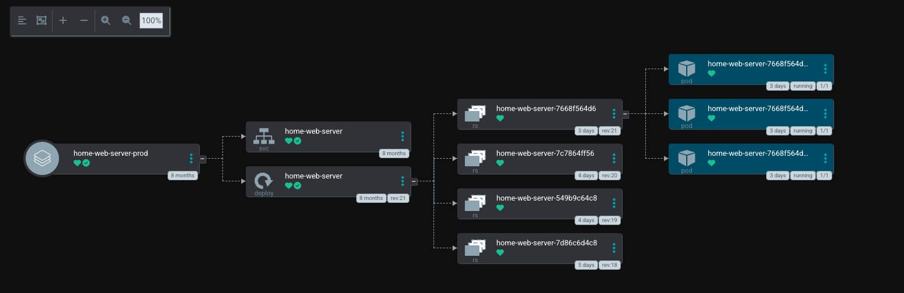

実はこのブログ、JavaScript(TS)やフロントエンドのフレームワークを使用せずに、さらにLLMに書いて貰わず手書きで作ってみています。

この記事では簡単に、どう作っているのか、また作ってみての感想について現時点のスナップショットとして書き留めておこうと思います。

## 全体の要件

執筆体験として譲れないものを中心に洗い出し、以下の要件を考えました。

- 執筆体験に関わる要件
  - 執筆者はmarkdownファイルだけを書くだけで済むこと
  - ローカルのテキストエディタで執筆が完結すること（外部ストレージへの画像の手動アップロードなどはしない）
  - ローカルでも記事の見栄えを確認できること
  - GitHubのmainブランチにmergeされたことをトリガーとしてリリースされること
- リリース先に関わる要件
  - お家のコンピューターリソースを使用してリリースすること
- ブログ自体に関する要件
  - トップページはプロフィールなどを記載すること
  - トップページには最新の記事が並ぶようにすること

特にこだわったのが、**私がmarkdownだけ執筆すればいい状況**を作る部分です。できるだけ依存を減らして、どんな環境でも執筆できることを重視しました。

書くハードルをさげて自分のブログを愛すことができることにつながることを期待しています。

## 実際に出来上がった記事執筆の流れ

執筆からリリースの大まかなフローとしては、以下のようになっています。

1. `mise run new`で現在の時刻をもとにしてディレクトリとテンプレのmarkdownが作成される
2. markdownにメタ情報（タグやカテゴリなど）と、本文を書き込む
3. `mise run build`, `mise run debug`でbuild+ローカル環境での確認
4. mainにmergeして実際にリリース

かんたん！

## どう実現しているか

記事のbuildからリリースの流れは、自分でgoのスクリプトを用意して実現しています。

また、リリース先はnginxのコンテナに、作られたHtmlを詰め込む形で達成されています。

詳しくは次のセクションで掘り下げます

※ブログ自体はパブリックのGitHub repositoryで公開していますので、気になる方はみてみてください！↓

blog(GitHub) [https://github.com/3l4l5/blog](https://github.com/3l4l5/blog)

### markdownをどうブログ記事として配布するか？→markdownのhtml変換

markdownの変換はgoldmarkというライブラリを使用させてもらっています。

goldmark [https://github.com/yuin/goldmark](https://github.com/yuin/goldmark)

これを用いて、執筆したmarkdownを一旦メモリ上に持ち、後述する画像pathの変換を行ったのちにdist以下に結果を保存します

### 画像の扱いをどうするか？→画像のS3（互換オブジェクトストレージ）へのアップロードで解決

画像をnginxのコンテナ内に入れ込んでリリースすることは可能なのですが、そうすると将来的に画像が増えていったとき、イメージサイズが際限なく大きくなっていってしまいます。

現在、nginxのコンテナはAmazon Elastic Container Registry(ECR)上にpushしているため、イメージサイズが大きくなると転送料金の増大などのリスクが見込まれました。そのため、nginxに画像も詰め込む方式はあまり筋の良い方針ではないと判断しました。

最終的には、自宅にS3互換ストレージ（RustFS）を立て、画像のみそこのpublic bucketにアップロードをする。その後、HTMLに含まれる画像pathをアップロード先のURLに置き換える処理を行っています。

RustFS　[https://github.com/rustfs/rustfs](https://github.com/rustfs/rustfs)

これにより、ローカルでの執筆中は、markdownからの相対pathで画像を指定するだけで、どのようなmarkdown iewerでも画像をプレビューしながら執筆することができ、かつimageサイズの増大も防げるという２粒おいしい結果を得ることができました。

置き換えには、markdownから画像が指定されているところを正規表現で抜き出して、指定されている画像を探してくる必要があるため、地味にめんどくさかったです。

### mainにmergeされたらリリースされる

md→htmlの変換や、S3への画像のアップロードを終えた後、HTMLをdocker imageに焼き込んでECRへPushします。これらをGitHub Actionsで行っています。

そうすると、nginxコンテナは自宅のk8sクラスタにリリースされて、mainにmergeされたことをトリガーとして自動的に使用されるimageを切り替えてくれます。

嬉しいですね！

ただ、ここまでやったうえで考えると、S3（RustFS）へ記事のhtmlもアップしてしまって、そのURLにnginxがプロキシしてくれるようにすれば、いちいちimageのbuildがいらなくなり、リリースの待ち時間がほぼなくなるなぁ、と思っています。

### どこにリリースするか問題→おうちk8sクラスタ

ECRに新しいイメージがPushされると、Argo CD Image Updaterが新しいイメージを検出してKubernetes Manifest上のイメージを更新し、Argo CD経由でクラスタへ反映されます。

↑ argocdの画面

そして常に3つのpodが秒間0.000リクエストを捌いています！

オーバーテクノロジーですが面白いからいいよね。

実際には、MetalLBを使ってKubernetesのLoadBalancer ServiceにLAN内からアクセス可能なローカルIPを払い出し、そのIPに対してCloudflare Tunnel経由でLAN外からアクセスできるようにしています。

cloudflare tunnelsがなかったら、めんどくさかったので、cloudflare様には足を向けて寝られません。

## なぜそんなことしているのか？

なぜこんなフレームワークも使わずに車輪の再発明ブログを作るっているかというと、一種のゲームの縛りプレイみたいな感覚で、面白そうだからやっています。最初は特にそれ以上の深い意図はありませんでした。

ただ、やはり自分で手書きしていると、思わぬところで躓きます。恥ずかしながら実は、「OGPがどのように作られるのか」や、「go langでの非同期処理の書き方」など、あまり詳しくありませんでした。そのため、今回実際に実現方法を調べながら実装を進めていくことにより、フレームワークに隠蔽されていたり、AIが勝手にやってくれるような部分を改めて勉強することができました。

「知ってるけど、本当はできないこと」みたいなものが、最近ではLLMのおかげで実装できてしまいます。アウトプットにかかる時間も短縮され、大変喜ばしいことなのですが、私個人の印象としては知的好奇心があまり満たされない感覚がありました。

このブログ作りを通して、久しぶりに手触り感のあるプログラミングができた気がします！

こんなものが何かの役に立つかどうかはわかりませんが、楽しかったので満足です。趣味なのでね〜！

## これからやりたいこと

これからは、以下の部分をちょっとずつやっていきたいなと思っています

- OGP画像の自動生成＋upload
- 埋め込まれたURLのOGPを習得→記事内に展開
- そもそもnginxコンテナ内に記事を入れておく必要がないので、記事自体もS3にアップロードする形に変更
- 記事の生成＋リリース部分のみを抽出してOSS化
- 閲覧数表示、リアクションボタン（👍, 👎, ❤️みたいな絵文字で読んだ人が反応できるようにする機能）をつける

閲覧数やリアクションボタンを作る頃には、さすがにJSを使いたくなるだろうなとは思っていますが😅、そんなに気にせず自分が楽しめる範囲で作っていければと思っています。

