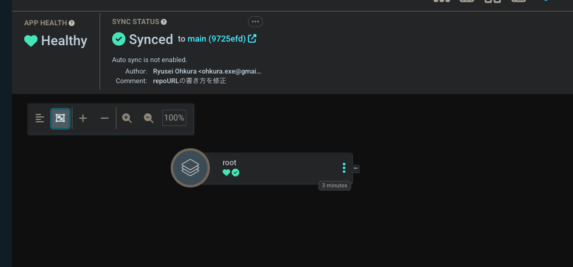
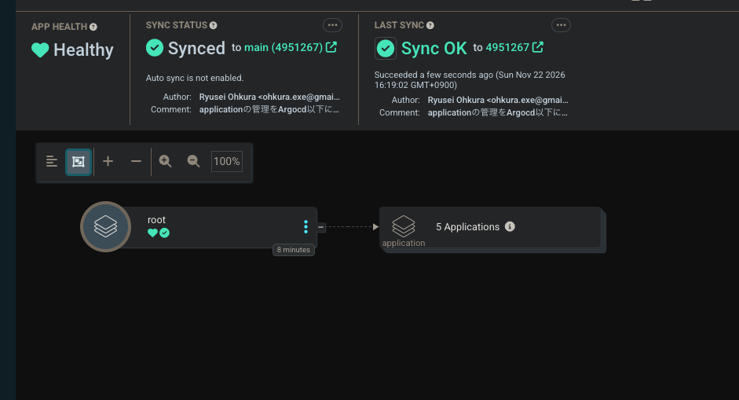

## argocd App of Apps

お家のkubernetesサーバーにあるapplicationの登録など、今はargocd用のyamlを書いて、それをkubectl apply -f でapplyしてたけど、argocdの中のプロジェクト自体をargocdで管理する App of Appsという方法で管理すると、Argocdのプロジェクト自体も GitOpsできるらしい。

いいね。やってみよう。

yaml の例

```yaml
apiVersion: argoproj.io/v1alpha1
kind: Application
metadata:
  name: root
  namespace: argocd
spec:
  project: default
  source:
    repoURL: https://github.com/<you>/<gitops-repo>.git
    targetRevision: main
    path: argocd
    directory:
      recurse: true          # projects/ と applications/ を両方読む
  destination:
    server: https://kubernetes.default.svc
    namespace: argocd        # Application や AppProject は argocd namespace に作られる
  syncPolicy:
    automated:
      selfHeal: true
      prune: false           # 最初は false。慣れたら true も検討
```

kindのApplicationは、ArgoCdが追加した独自のリソースの種類。


## kind: AppProject

AppProjectは、Applicationをグループにまとめて、「このグループのApplicationは何をしてよいか」を制限する仕組み。ArgoCDのApplicationをひとまとまりで管理できるもの。

```yaml
apiVersion: argoproj.io/v1alpha1
kind: AppProject
metadata:
  name: apps
  namespace: argocd
spec:
  sourceRepos:                     # どこから取ってきてよいか
    - https://github.com/<you>/<gitops-repo>.git
  destinations:                    # どこにデプロイしてよいか
    - server: https://kubernetes.default.svc
      namespace: 'home-*'
  clusterResourceWhitelist: []     # クラスタ全体に効くリソース（StorageClass など）は作らせない
```

infra用のApplicationのセットなどを作っておいて権限管理するのがいいそう。なるほど。



applyしたらできた。

ここにApplicationを移していけばいいんだな？

すでにArgoCDのApplicationsがArgoCD管理下なのでリポジトリにpushすれば、今までコマンドで建ててきたApplicationがここに紐づくようになるはず。



いけた。嬉しい。

アプリ作るたびに面倒なあれこれをしていたのを、GitOpsで管理できるようになったね。ハッピー

## kubernetesでどうやって秘密情報を管理するか

大体3択

- Sealed Secrets
- SOPSなど
- 1PasswordやVaultなどから取って来させる方式

手軽さからSealed Secretsを試す

Sealed Secretsとは、kubernetesのSecretリソースを暗号化して管理できるOSSツール。

クラスタ側と暗号化したい側で秘密鍵と公開鍵のセットを作成し、開発時に公開鍵で暗号化、実際に展開する時にクラスタ側で秘密鍵を用いて複合化するというもの。

便利だね

Sealed Secretsを追加すると、SealedSecretというリソースが追加されて使えるようになる。

具体的にSecretを反映させるための大まかな流れは以下

1. (開発者PC)kubesealコマンドでsecretsの内容を公開鍵で暗号化,結果をsealed-secret.yamlに保存（kindがSealedSecretになる）
2. (開発者PC) sealed-secret.yamlをGitにpushする
3. (cluster)SealedSecretを復号してSecretとして展開

いい感じ

### すでにsecret.yamlとして存在しているsecretをsealする方法

以下のコマンド。

secrets.yamlを読んで、kubesealで暗号化したものをsealed-secret.yamlにしているだけ


```
kubeseal --format yaml < secret.yaml > sealed-secret.yaml
rm secret.yaml  
```

⚠️すでにsecret.yamlがGit管理下にある場合は、Secret自体の再発行をするべき。

### 新しく使いたいsecretを作成する方法

いろいろ方法があるみたいだけど、一旦secret.yamlを自分で作って、それを暗号化する（ほぼ上の方法と同じ）が手軽そう。

### つまずき

問題：すでにあったSecretをSealしてpushしてもArgocdがうまくSecretを展開できなかった。

原因：同じ名前のSecretを別の系統から投入していたため、上書きせずにsealed-secretsのcontrollerがストップした

解決策：明示的に元々存在したSecretの管理をsealed-secretsのコントローラーが巻き取ることを宣言することで解決した

以下のコマンド

```bash
# rustfsのsecretsの管理を、sealed secretsが指定いと明示的に指示
kubectl annotate secret rustfs-credentials -n rustfs \
  sealedsecrets.bitnami.com/managed="true" --overwrite

# 再度実行
kubectl rollout restart deployment sealed-secrets-controller -n kube-system
```

※rolloutは、Deploymentなどの入れ替え作業をいじるコマンド

・・・

sealed-secretsのArgoCD管理用manifestファイルは以下

```yaml
apiVersion: argoproj.io/v1alpha1
kind: Application
metadata:
  name: sealed-secrets
  namespace: argocd
spec:
  project: default
  source:
    repoURL: https://bitnami-labs.github.io/sealed-secrets
    chart: sealed-secrets
    targetRevision: 2.22.0
    helm:
      releaseName: sealed-secrets
      valuesObject:
        fullnameOverride: sealed-secrets-controller
  destination:
    server: https://kubernetes.default.svc
    namespace: kube-system
  syncPolicy:
    automated:
      selfHeal: true
      prune: false
```