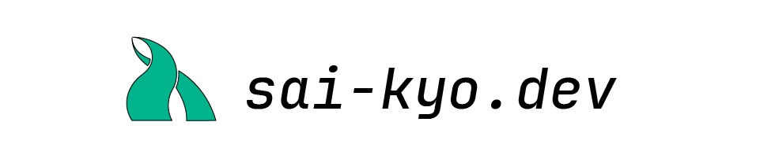
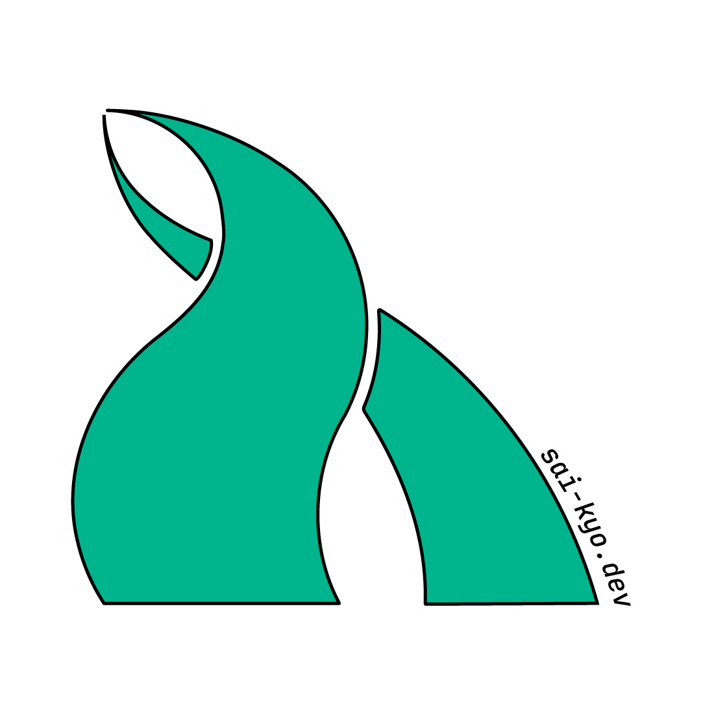
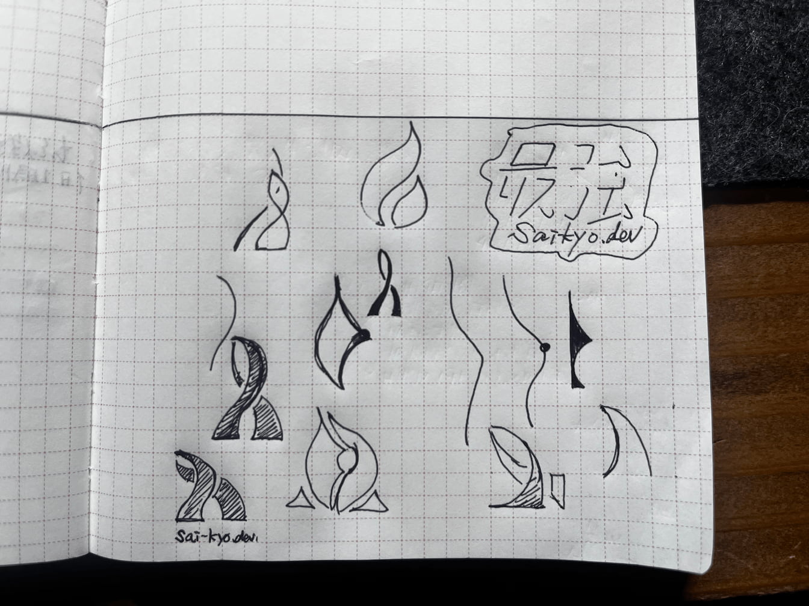
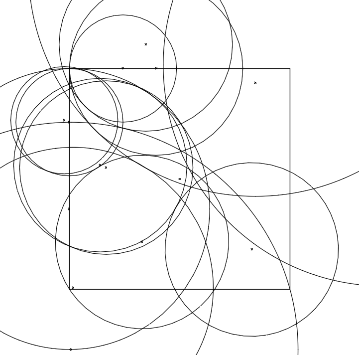
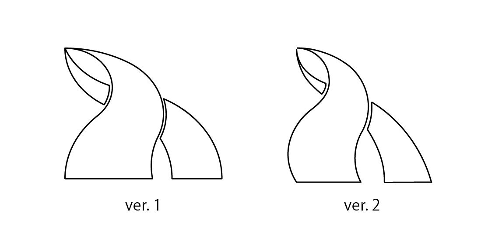

埼京.devは私と0yuさんときたじーさんで運営する赤羽を中心に活動してるエンジニアコミュニティです。

埼京devのconnpassページ：[https://sai-kyo.connpass.com/](https://sai-kyo.connpass.com/)

2025/12/9が埼京.dev第一回の開催でしたので、もうすぐ1周年になります。

それに際してブランドロゴ的なものを作ったので記事としてここに残します！

日本語ver

英語ver

ロゴ

いい感じにできました

## ロゴに込めた想い

ロゴには、私たちの活動している赤羽駅が、埼京線と京浜東北線両方の重なる駅であるという特徴を前面に出してみました。

また、「最強！」への想いを表すような炎、そして地域に根ざしたコミュニティを目指したいという想いを「根」として表現しています。

みなさんの近くに埼京を感じてもらうために、これからTシャツやステッカーを作っていきたいです！

## 制作にあたり

今回は、Illustratorの使い方にも慣れたいので頑張って使ってみました。

少し使い慣れるととても便利で、いろんなものが作れそうです！

また、今回は人間が美しいと感じるとされる黄金比の円を組み合わせてデザインしています。

ver.1 は特に黄金比は気にせず作ったもの。ver.2 は黄金比の円を組み合わせて作ったものです。

これは、黄金比に揃えたことが原因かどうかはわかりませんが、ver1よりもver2の方が洗練されたイメージになった気がします。面白い！

## 最後に

こんな時代になんで時間をかけて作ってるのかとも思いますが、楽しかったのでよしとします。

デザインは本業ではないですが、こういうちまちま動かしながら自分のイメージに合うものを作っていくという活動はどうしても嫌いになれないですね。

Illustrator力も上がったのでヨシとします。

これからも埼京.devをみんなにとっての居心地の良い場所であってもらえるため、いろいろやっていければと思います！

埼京.devをよろしくお願いします〜！

最強！！